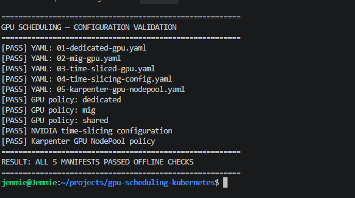
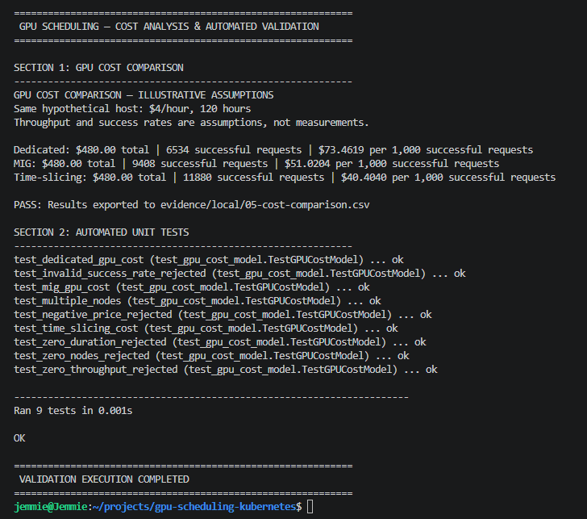

# GPU Scheduling — Validation Evidence

## Overview

This directory contains reproducible validation evidence for the Kubernetes GPU scheduling evaluation.

Evidence is separated into configuration validation, automated testing, and cost modelling. Results are reported according to the verification method actually executed.

## Evidence Register

| ID | Evidence | Validation Scope | Result |
|---|---|---|---|
| E01 | [GPU Configuration Validation](local/04-configuration-validation.md) | YAML parsing and scheduling policy consistency | PASS |
| E02 | [Cost Model Execution](local/05-cost-model.log) | Python cost calculations | PASS |
| E03 | [Cost Comparison](local/05-cost-comparison.csv) | Exported scenario results | PASS |
| E04 | [Automated Unit Tests](local/05-unit-tests.log) | Cost arithmetic and invalid-input handling | 9 PASS |

## Verified Results

### Configuration Validation

Five Kubernetes YAML manifests passed offline parsing and selected scheduling-policy checks.

The checks covered dedicated GPU, MIG, time-slicing, and Karpenter reference configurations.

### Automated Testing

Nine Python unit tests passed, covering:

- Dedicated GPU cost calculations
- MIG cost calculations
- Time-slicing calculations
- Multi-node scenarios
- Invalid parameter rejection

### Cost Analysis

The hypothetical 120-hour cost model produced:

| Strategy | Total Cost | Successful Requests | Cost per 1,000 |
|---|---:|---:|---:|
| Dedicated | $480 | 6,534 | $73.46 |
| MIG | $480 | 9,408 | $51.02 |
| Time-slicing | $480 | 11,880 | $40.40 |

The cost, throughput, and success-rate inputs are assumptions rather than measured infrastructure results.

## Validation Boundaries

The evidence demonstrates executed offline configuration checks, Python unit tests, and reproducible cost calculations.

Live GPU allocation, MIG hardware partitioning, Kubernetes scheduler events, and GPU node autoscaling have not been verified on a physical GPU-enabled cluster.

## Reproduction

From the repository root:

```bash
python3 scripts/gpu_cost_model.py
python3 -m unittest discover -s tests -v
```

Compare the generated results with the files in `evidence/local/`.

## Conclusion

The recorded checks support the correctness and reproducibility of the reference configurations and analytical cost model within their tested scope.

Hardware-dependent deployment and performance conclusions require additional validation on compatible infrastructure.

## Screenshot Evidence

### 01 — GPU Configuration Validation



Offline validation of five Kubernetes manifests and their GPU scheduling policies.

### 02 — Cost Model and Automated Tests



Reproducible cost analysis and nine passing Python unit tests.